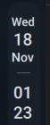

# Flex Clock

A clock for the DMS bar that takes your own time and date formats, and looks right on left and right bars too.



The built-in clock ignores the custom date format on vertical bars and always stacks the date as numbers. Flex Clock lets you pick each line yourself, so `d|MMM` gives you `18` over `Nov`.

## Features

- Separate formats for vertical (left/right) and horizontal (top/bottom) bars
- Presets for common layouts, or your own format with a live preview in settings
- Smaller AM/PM, with an adjustable size
- `*bold*`, `~dim~` and `!accent!` styling for parts of a format
- Date card on right-click: full date, week number, day of year and a month calendar
- Leave a format empty to follow DMS's Time & Date settings (12/24h, seconds, AM/PM)

## Format

Qt date/time tokens, as in DMS's custom date format:

| Token | Meaning | Token | Meaning |
|---|---|---|---|
| `h` `hh` | hour 1–12 | `d` `dd` | day |
| `H` `HH` | hour 0–23 | `ddd` `dddd` | weekday |
| `mm` | minute | `M` `MM` | month number |
| `ss` | second | `MMM` `MMMM` | month name |
| `AP` `ap` | AM/PM | `yy` `yyyy` | year |

Flex Clock adds:

| Syntax | Effect |
|---|---|
| `\|` | new line |
| `*…*` | bold |
| `~…~` | dim |
| `!…!` | accent color |
| `'…'` | literal text |

Examples: `hh|mm|AP`, `*hh*|~mm~|AP`, `ddd|*d*|!MMM!`, `ddd d MMM`.

## Install

```sh
git clone https://github.com/jibon-k/dms-flex-clock ~/.config/dms/plugins/flexClock
```

Enable it in Settings → Plugins, then add **Flex Clock** to a bar.

## Requirements

DMS 2.0 or newer. No external dependencies.

## License

MIT
